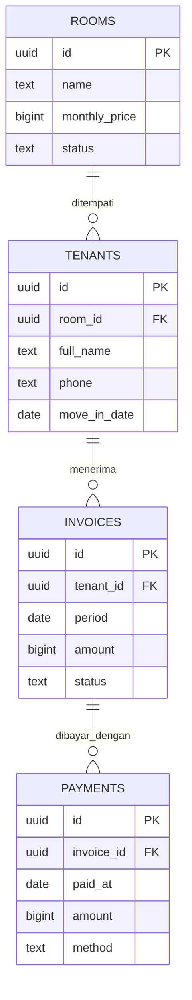

# KostPay

Sistem pembayaran kos sederhana dengan empat entitas: kamar, penghuni, tagihan, dan pembayaran.

## Menjalankan frontend

Buka `frontend/index.html` langsung di browser. Tidak memerlukan build tool atau library eksternal. Agar semua pengunjung langsung memakai project yang sama, isi `projectUrl` dan `publishableKey` sekali di `frontend/config.js` sebelum membagikan atau memublikasikan folder `frontend`. Pengaturan yang sudah tersimpan di browser tertentu tetap menjadi pilihan browser tersebut; tombol **Gunakan konfigurasi bawaan** menghapus pilihan lokal dan kembali ke nilai `config.js`.

## Menyiapkan database

1. Buat project di Supabase.
2. Buka **SQL Editor** pada dashboard Supabase.
3. Jalankan isi `database/schema.sql`.
4. Salin Project URL dan Publishable Key dari pengaturan API project ke KostPay.

Frontend berkomunikasi langsung dengan Supabase REST API. Kebijakan SQL saat ini memberi akses CRUD kepada role `anon` supaya aplikasi bisa dipakai tanpa login. Ini cocok untuk tugas/demo; jangan gunakan kebijakan terbuka ini untuk menyimpan data penghuni sungguhan di project produksi. Publishable key aman untuk frontend, tetapi jangan pernah memakai `service_role` key.

## Backend opsional

`backend/app.js` adalah proxy REST opsional yang memakai modul bawaan Node.js (Node 18+), tanpa package.json atau dependensi npm. Jalankan dengan `node backend/app.js`; frontend yang dibuka langsung tetap memakai Supabase secara langsung dan tidak bergantung pada backend ini. Endpoint pemeriksaan tersedia di `http://localhost:3001/api/health`.

Untuk memakai proxy, request ke `/api/rooms`, `/api/tenants`, `/api/invoices`, atau `/api/payments` dengan header `x-supabase-url` berisi Project URL dan `apikey` berisi Publishable Key. Query string dan metode GET/POST/PATCH/DELETE diteruskan ke Supabase.

## Relasi ERD

- Satu kamar dapat ditempati banyak penghuni sepanjang waktu; setiap penghuni terhubung ke satu kamar.
- Satu penghuni memiliki banyak tagihan.
- Satu tagihan dapat memiliki banyak pembayaran.
- Status tagihan otomatis menjadi lunas saat total pembayaran mencapai jumlah tagihan.

